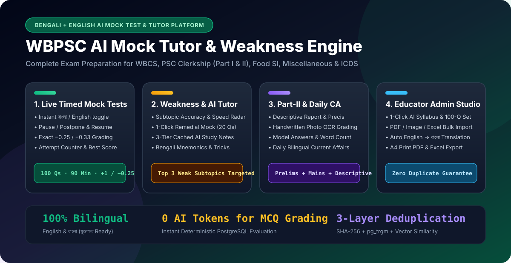
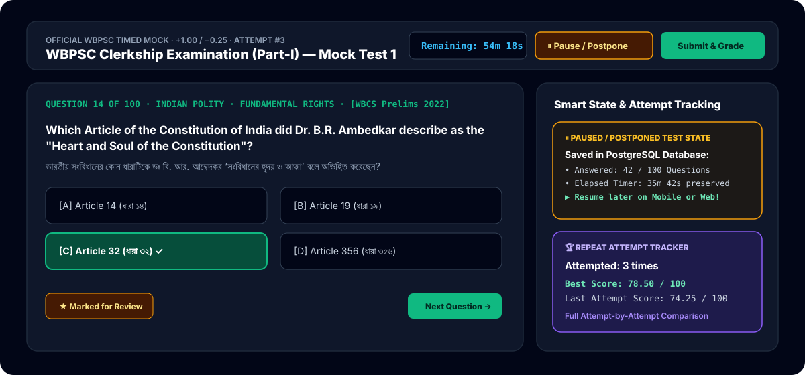
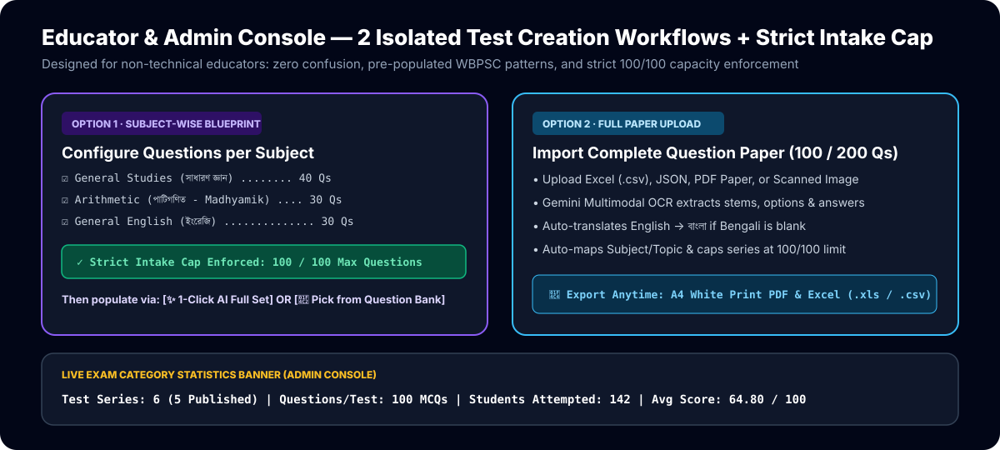
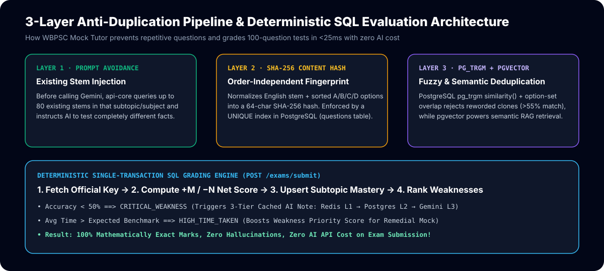

# WBPSC AI Mock Tutor & Weakness Engine
### *The Complete Bilingual (বাংলা + English) Exam Preparation, AI Tutoring & Educator Studio Platform for West Bengal Government Exams*

---

## 🌟 Executive Summary (Why WBPSC AI Mock Tutor Stands Apart)

Preparing for West Bengal Public Service Commission (**WBPSC**) examinations—such as **WBCS (Prelims & Mains)**, **PSC Clerkship (Part-I MCQ & Part-II Descriptive)**, **Food SI**, **Miscellaneous Services**, and **ICDS Supervisor**—requires more than static PDFs or generic national test apps. Aspirants need **authentic Bengali & English bilingual questions**, **exact negative-marking practice**, **scientific identification of weak chapters**, and **descriptive answer writing evaluation**.

At the same time, coaching institutes, educators, and exam administrators need a **zero-headache studio** where they can create full 100-question or 200-question mock tests in minutes—whether by uploading a PDF/Excel paper or generating subject-balanced question sets with AI—without ever worrying about duplicate questions or technical complexity.

**WBPSC AI Mock Tutor** brings both worlds together into one lightning-fast Web & Android platform.

---

## 🎯 Target Examinations Covered Out-of-the-Box

| Examination Category | Pattern Supported | Marking Scheme | Medium |
| :--- | :--- | :--- | :--- |
| **WBCS Preliminary Examination** | 200 MCQs · 8 Subjects · 150 Mins | `+1.00` / `−0.25` | বাংলা + English |
| **WBCS Mains Examination** | 200 MCQs + Descriptive Papers · 180 Mins | `+1.00` / `−0.25` | বাংলা + English |
| **WBPSC Clerkship (Part-I MCQ)** | 100 MCQs (GS 40 · Arithmetic 30 · English 30) · 90 Mins | `+1.00` / `−0.25` | বাংলা + English |
| **WBPSC Clerkship (Part-II Descriptive)** | Report Writing, Précis & Translation · 60 Mins | AI Rubric Evaluation | বাংলা + English |
| **WBPSC Food SI** | 100 MCQs (GS 50 · Arithmetic 50) · 90 Mins | `+1.00` / `−0.25` | বাংলা + English |
| **WBPSC Miscellaneous Prelims & Mains** | 100 MCQs · 90 Mins | `+1.00` / `−0.25` | বাংলা + English |
| **WBPSC ICDS Supervisor** | 100 MCQs · 90 Mins | `+1.00` / `−0.25` | বাংলা + English |

---

## 👨‍🎓 Part 1: Student & Aspirant Experience

### 1. Authentic Bilingual Timed Mock Test Engine (বাংলা + English)
- **One-Click Language Switch:** Students can toggle between **বাংলা (Bengali)** and **English** at any moment—even in the middle of a running exam. Every question stem, all four options (`A`, `B`, `C`, `D`), and detailed post-exam explanations are available in crisp Bengali (`Noto Sans Bengali` / `Hind Siliguri`) and English.
- **Official Exam Conditions:** Real-time countdown timer, per-question time tracking, negative marking (`−0.25` or `−0.33`), and expected cutoff comparison.
- **Interactive Question Palette:** Color-coded navigation palette showing **Answered**, **Marked for Review**, **Answered & Marked**, and **Unanswered** questions so students can manage their exam strategy at a glance.
- **Anti-Cheat Architecture:** Correct answers and explanations are never sent to the browser while a test is running—preventing inspection via browser tools.

### 2. Pause / Postpone & Resume Ongoing Exams Anytime
- **Life Happens—Never Lose Progress:** If a student needs to step away during a 90-minute or 150-minute exam, they can click **"Pause / Postpone Test"**.
- **Complete State Preservation:** The platform saves the student's **exact remaining timer**, **every selected option**, **questions marked for review**, and **the exact question number** they were on directly in the cloud database.
- **1-Click Resume Across Devices:** When the student returns (even on another device), a prominent **"Paused / Postponed Ongoing Tests"** banner and card badge let them click **"Resume / Continue Exam"** to pick up right where they left off—or start fresh if they prefer.

### 3. Repeat Attempt Counter & Personal Best Tracking
- **Track Every Retake:** Every Exam Card and Test Series Card displays a live badge showing **how many times the student has attempted that test** (e.g., `Attempted: 3 times`).
- **Best Score vs. Last Score:** For students who retake mock tests to improve speed and accuracy, each card displays their **Best Score** alongside their **Last Score**, encouraging measurable progress until they clear the official cutoff.
- **Full Question-by-Question Review:** After submitting any attempt, students can open a complete review sheet comparing their chosen option against the official answer key, marks awarded (`+1` or `−0.25`), time spent on that question, and a bilingual step-by-step explanation.

### 4. Scientific Weakness Radar & 1-Click Remedial Mock Tests
- **Automatic Subtopic Mastery Matrix:** Every time a student submits a test, the platform analyzes their accuracy and speed across every individual chapter and subtopic (e.g., *Fundamental Rights*, *Ratio & Proportion*, *Governor-General & Viceroys*).
- **4-Band Mastery Classification:**
  - 🔴 **Critical Weakness** (`< 50%` accuracy)
  - 🟠 **Needs Revision** (`50% – 69%` accuracy)
  - 🔵 **Proficient** (`70% – 84%` accuracy)
  - 🟢 **Exam Ready** (`85%+` accuracy)
- **Slow-Solving Detection:** Even if a student gets a question right, if they take longer than the target time benchmark (e.g., `> 60 seconds` on an Arithmetic problem), the engine flags `HIGH_TIME_TAKEN` so they can build exam speed.
- **1-Click Remedial Mock (Top 3 Weak Subtopics):** With a single click on **"Launch Remedial Mock"**, the platform builds a custom 20-question mini-test drawn exclusively from the student's **3 weakest subtopics** using questions they haven't solved yet.

### 5. Instant AI Personal Tutor (Bilingual Study Notes & Mnemonics)
- **Targeted Concept Notes:** Clicking any weak subtopic in the Weakness Radar opens a structured, exam-focused study note in **Bengali or English**.
- **High-Yield Exam Content:** Includes bullet-point summaries, key dates/articles/formulas, **Bengali memory mnemonics (মনে রাখার কৌশল)**, and **Previous Year Question (PYQ) trends** showing how WBPSC frames questions from that topic.
- **Instant Delivery:** Powered by a 3-Tier Smart Cache—once a note is generated for a subtopic, every student gets it in **under 10 milliseconds**.

### 6. WBPSC Clerkship Part-II & WBCS Mains Descriptive Answer Evaluator
- **Type or Upload Handwritten Answer Sheets:** Students can either type their Bengali/English descriptive answer or **upload a photo of their handwritten notebook page**.
- **AI OCR & Rubric Grading:** The platform transcribes handwritten Bengali/English text and grades the answer across three official parameters:
  1. **Grammar & Spelling Score** (বানান ও ব্যাকরণ)
  2. **Content & Structure Score** (বিষয়বস্তু ও গঠন)
  3. **Word-Limit Adherence Score** (শব্দসীমা)
- **Actionable Feedback & Model Answer:** Provides specific strengths, line-by-line improvements needed, and a **full-marks Model Answer** for reference.

### 7. Automated Daily Current Affairs & Memory Tricks
- **Daily Bilingual Digest:** Synthesizes West Bengal State Affairs, National Economy, Science & Tech, and Awards into concise bilingual revision cards with exam-ready one-liners and memory mnemonics.

---

## 🛠️ Part 2: Educator & Admin Studio (Zero-Confusion Management Console)

Designed specifically so **non-technical educators, coaching owners, and content creators** can run an entire test series platform effortlessly.

### 1. Live Category Statistics Banner
- At the top of every Exam Category in the Admin Console, educators see a real-time executive summary:
  - **Total Test Series** (Published vs. Draft)
  - **Questions per Test & Total Bank Supply**
  - **Total Students Attempted** (Unique students + total test attempts)
  - **Overall Average Score** across all student attempts in that exam category

### 2. Two Strictly Isolated Ways to Create a Test Series
To eliminate any confusion when creating a new Mock Test Series, the Admin Console presents **two clean, isolated options**:
- **Option 1 · Subject-Wise Blueprint (Set Questions per Subject → AI or Question Bank):**
  - Pre-populated with official WBPSC subject weightages (e.g., *General Studies: 40, Arithmetic: 30, General English: 30 = 100 Questions*).
  - **Strict Total Question Cap Enforcement:** If an exam's maximum intake is set to **100 questions**, the system strictly prevents configuring or inserting more than 100 questions (eliminating any `135/100` overflow).
  - Educators then choose with one click whether to **Generate the Full Question Set by AI** according to those exact subject counts, or **Pick Questions from the Question Bank**.
- **Option 2 · Full Question Paper Upload (100 Qs Clerkship / 200 Qs WBCS):**
  - Upload a complete question paper in **Excel (`.csv`), JSON, PDF, or Scanned Image** format.
  - The system automatically extracts all questions, translates missing Bengali text, maps subjects/chapters, inserts them into the Question Bank, and attaches them to the Test Series up to the exam's maximum question limit.

### 3. 1-Click AI Bulk Syllabus & Full Question Set Generator
- **1-Click AI Syllabus Builder:** Generates the complete bilingual **Subjects → Chapters → Subtopics** hierarchy for any exam (Mathematics, History, Geography, Polity, Economy, Science, Reasoning, English, Current Affairs), while intelligently skipping subjects or topics that already exist.
- **Full CRUD & Safe Cascade Deletion:** Educators can add, edit, or delete any Subject, Chapter, or Subtopic—including a safe **Cascade Delete** option when a syllabus branch already contains questions or test series references.
- **Flexible AI Question Generator:** Generate questions for a single topic (choose **10, 15, 20, 25, 30, 40, or 50 questions** from the dropdown) or generate an entire **100-question multi-subject exam set** in a single click.

### 4. Smart English → বাংলা Auto-Translation for Educators
- When framing a single question or uploading a bulk sheet, educators only need to type the **English** question and options.
- They can either click **"✨ Auto-Translate to বাংলা (AI)"** to preview and edit the Bengali text immediately, or **leave the Bengali fields blank**—the backend automatically translates the stem, all 4 options, and the explanation into natural exam-standard Bengali when saving!

### 5. Print-Ready A4 PDF & Excel Export of Any Test Series
- Educators can export any Test Series at any time in two formats:
  1. **Excel (`.xls` or `.csv`):** Complete bilingual spreadsheet with Question #, Subject, Chapter, Subtopic, English & Bengali Stems, Options A–D, Correct Answer, Explanation, Difficulty, and PYQ Tags.
  2. **Formatted A4 PDF Question Paper & Answer Key:** Opens a dedicated, crisp white A4 print sheet supporting **Bilingual (EN + বাংলা)**, **English Only**, or **Bengali Only** layouts, with flexible answer placement (**Answer Key at End of Paper**, **Inline Solutions below each question**, or **Question Paper Only** for classroom distribution).

---

## 🔒 Quality, Speed & Reliability Highlights

- **Zero Duplicate Questions:** A 3-layer deduplication shield (Prompt Avoidance + SHA-256 Content Fingerprint + Fuzzy & Semantic Similarity) guarantees that students and educators never see repetitive questions.
- **100% Mathematically Accurate Grading:** All MCQ scoring, negative marking, and weakness calculations run inside a deterministic PostgreSQL transaction—meaning **zero AI hallucinations** and **instant results in milliseconds**.
- **Works Seamlessly Across Web & Mobile:** Responsive Web App for desktop/laptop/mobile browsers + React Native Android App support.

---

*Prepared for Marketing, Product Demonstrations, Institutional Partnerships & Educator Onboarding.*
